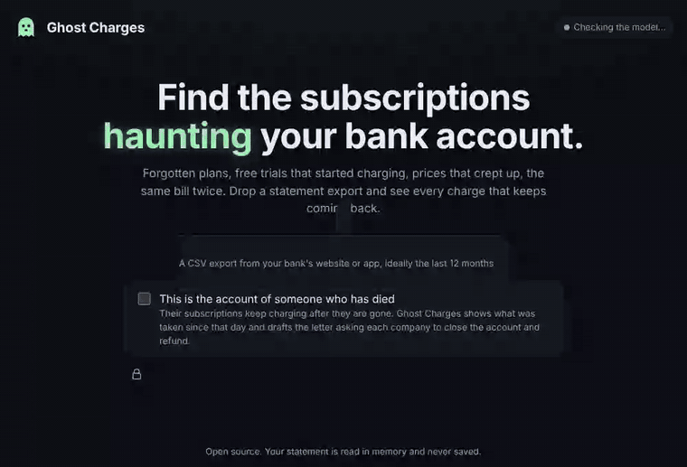

# Ghost Charges

**Find the subscriptions that keep charging a bank account, including the account of someone who has died, and write the letters that stop them.**

When someone dies, their subscriptions don't. The streaming plan, the gym, the phone line and the app they tried once go on charging the account until a family member, in the worst weeks of their life, reads twelve months of bank statements line by line. Ghost Charges reads the statement for them.

Drop a CSV export from any bank. Ghost Charges finds every payment that comes back at a steady rhythm, shows which ones are still running, which went up in price, which started as a free trial and which were charged twice. Tick *"This is the account of someone who has died"*, add the date, and it shows what each company has taken since that day and drafts the letter asking them to close the account and refund it, in English, Italian, German, Spanish or French.

It runs on your own computer with an open-weight model (Gemma, through Ollama). A bank statement is the most private file most people own: nothing in it needs to leave the machine.



## The model reads, the code decides

| Job | Who does it | Why |
|---|---|---|
| Read the CSV: columns, dates, amounts, debit or credit | code (`app/statement.py`) | Numbers and dates must be exact. |
| Find the series: cadence, steady amount, price rises, trials, doubles, still active | code (`app/ghosts.py`) | Arithmetic on dates, testable. |
| Say who the merchant is: `HLLFRSH*HELLOFRESH US` and `HELLOFRESH 646-846-3663` are one company | Gemma (`app/names.py`) | Banks write the same merchant a dozen ways. |
| Tell rent to a person apart from a subscription | Gemma | It repeats like one. |
| Write the human part of the letter | Gemma (`app/letters.py`) | Tone, in the family's language. |

The model is never trusted with a fact:

- A name is only kept if the bank's own text backs it: one of its words appears in the descriptions, or the bank wrote an abbreviation of it (`AMZN` for Amazon). A made-up name is dropped and the code's name is kept.
- The letter body is rejected if it contains a digit, a currency sign, a date, an email address or a link, and a fixed template is used instead. The name, the date of death and every charge since are added underneath by code, from the statement.
- If the model is off or fails, everything still works on rules alone.

## How well it works

`eval/` holds four invented statements in the formats of real Italian, British, American and German banks (172 to 182 rows each, 32 real subscriptions, 4 double charges, plus rent, groceries, utilities and day passes that are not subscriptions), with hand-checked answers in `eval/gold.json`. All the people and transactions are invented.

```
python3 scripts/eval.py            # rules only
python3 scripts/eval.py --model    # with the model in LLM_BASE_URL / LLM_MODEL
```

Rules only, today:

| | |
|---|---|
| subscriptions found | 30 / 32 |
| named right | 30 / 30 |
| still charging or stopped, right | 30 / 30 |
| price rise right | 30 / 30 |
| trial right | 30 / 30 |
| double charges found | 4 / 4 |
| false alarms | 5 (four rent payments to a person, one pharmacy) |

Be warned: the rules were fixed while looking at these four files, so this is the best case for rules. The two misses are the ones code can't solve: HelloFresh billed as both `HLLFRSH*HELLOFRESH` and `HELLOFRESH`, and Kindle Unlimited billed as both `AMAZON DIGITAL KINDLE UNLTD` and `Amazon Digital Germany GmbH`. Those, and rent, are what the model is for.

### A test it was not built on

`eval/heldout/` holds four more invented statements (French, Spanish, Revolut and Dutch ING formats, 30 subscriptions), made by a separate process that never saw this code. On the first run Ghost Charges read **none** of them: their headers and layouts were new to it. After fixing only the CSV reader, and leaving the detection code untouched:

| Rules only, held-out set | |
|---|---|
| subscriptions found | 25 / 30 |
| named right | 14 / 25 |
| false alarms | 8 (rent to a person, pharmacies) |
| double charges found | 3 / 4 |

Most wrong names are the bank's own words: `PRLV`, `Recibo`, `Compra`, `Pago`. That is the gap the model is there to close.

With **gemma3:4b running locally on a laptop with no GPU** (`eval/heldout/gemma3-4b-cpu.json`, 1.5 to 8 minutes per statement):

| Held-out set | rules only | with Gemma |
|---|---|---|
| subscriptions found | 25 / 30 | 25 / 30 |
| named right | 14 / 25 | **19 / 25** |
| false alarms | 8 | **5** |
| still charging or stopped, right | 25 / 25 | 25 / 25 |
| price rise right | not re-measured here | 20 / 25 |
| trial right | not re-measured here | 23 / 25 |
| double charges found | 3 / 4 | 3 / 4 |

The model does what it is there for: it reads the names and spots payments to people. It does not find more subscriptions, because finding them is the code's job. Of the 68 names it was asked for, it gave 61 that were kept, 2 were dropped because the bank's text did not back them, and 5 got no answer.

## Run it

```bash
pip install -r requirements.txt
ollama pull gemma3:4b            # or any model Ollama serves
uvicorn app.main:app --port 8000
```

Open http://localhost:8000 and drop a statement, or press *Try an invented statement*.

Any OpenAI-compatible endpoint works:

| Variable | Default |
|---|---|
| `LLM_BASE_URL` | `http://localhost:11434/v1` (Ollama) |
| `LLM_MODEL` | `gemma3:4b` |
| `LLM_API_KEY` | `ollama` |
| `LLM_TIMEOUT` | `600` seconds per call: a CPU needs minutes |
| `LLM_BATCH` | `10` merchants per call |
| `GHOST_NO_MODEL` | unset; `1` runs on rules only |

The hosted demo (`render.yaml`) uses Gemma through Google AI Studio and says so on the page: there, the merchant descriptions (not the amounts or the account) leave the server. Run it locally to keep everything on your machine.

## Privacy

The statement is read in memory and never written to disk. Only the merchant descriptions, at most three per merchant, are sent to the model endpoint you configure. By default that is Ollama on `localhost`.

## Tests

```bash
pip install -r requirements-dev.txt
GHOST_NO_MODEL=1 pytest -q
```

MIT licence.
